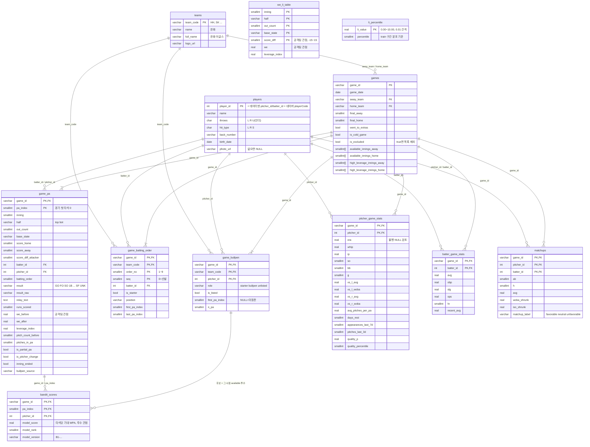

# K-Moneyball 서비스 DB ERD

PostgreSQL 13개 테이블 + Redis 세션. 2025 시즌만 적재한다.
✅ = ETL 완료(`etl/`), ⬜ = 예정.



## 테이블별 상태와 담당

| 테이블 | 상태 | 행 수| 쓰는 API |
|---|---|---|---|---|
| teams | ✅ 01 | 10  | /teams |
| players | ✅ 01·02 | 600  | 전부 |
| games | ✅ 03 | 720 (서비스 714) | /games |
| game_pa | ✅ 03 | 55,267  | /sessions, /recommend, /advance-half, /we-trace |
| game_bullpen | ✅ 04 | 19,592  | /recommend |
| game_batting_order | ✅ 04 | 16,321  | /sessions, /simulate-pa |
| pitcher_game_stats | ⬜ |  | /recommend |
| batter_game_stats | ⬜ |  | 타자 카드 |
| matchups | ⬜ || /recommend, 타자 카드 |
| we_li_table | ⬜ | 약 1.3만  | /simulate-pa, /advance-half |
| li_percentile | ⬜ | 1,001 | /recommend |
| bandit_scores | ⬜ | | /recommend (분기 전) |

## 시점 t 에서 자주 쓰는 조회

```sql
-- 현재 라인업 (공격팀 team_code, 현재 타석 t)
SELECT DISTINCT ON (order_no) order_no, batter_id
FROM game_batting_order
WHERE game_id = :gid AND team_code = :team AND first_pa_index <= :t
ORDER BY order_no, seq DESC;

-- 불펜 상태 (수비팀)
SELECT pitcher_id, role,
       CASE WHEN pitcher_id = :current_pitcher THEN 'current'
            WHEN first_pa_index < :t          THEN 'used'
            ELSE 'available' END AS availability
FROM game_bullpen
WHERE game_id = :gid AND team_code = :team;
```

## Redis (세션)

```
키   session:{session_id}     TTL 30분 (요청마다 연장)
값   { game_id, my_team, seed, dice_count, state, history[], used_pitchers[],
       pitch_counts{}, decisions[], is_diverged, diverged_at }
```
